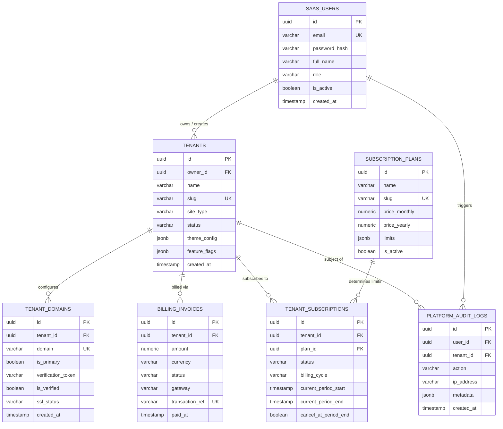

# SAAS_DB_STRUCTURE.md - Master Platform Database Schema

This document details the PostgreSQL relational database schema for the SaaS core platform layer, covering tenant management, custom domain mappings, subscriptions, billing, and system audit logs.

---

## 1. Entity Relationship Diagram (ERD)



---

## 2. Table Specifications & DDL Definitions

### A. Platform Users (`saas_users`)
Stores platform superadmins, support agents, and tenant owners.
```sql
CREATE TABLE IF NOT EXISTS saas_users (
    id UUID PRIMARY KEY DEFAULT gen_random_uuid(),
    email VARCHAR(255) NOT NULL UNIQUE,
    password_hash VARCHAR(255) NOT NULL,
    full_name VARCHAR(150) NOT NULL,
    phone VARCHAR(30),
    avatar_url TEXT,
    role VARCHAR(50) NOT NULL DEFAULT 'tenant_owner' 
        CHECK (role IN ('superadmin', 'support_agent', 'tenant_owner')),
    is_active BOOLEAN NOT NULL DEFAULT true,
    email_verified_at TIMESTAMP WITH TIME ZONE,
    last_login_at TIMESTAMP WITH TIME ZONE,
    created_at TIMESTAMP WITH TIME ZONE DEFAULT CURRENT_TIMESTAMP,
    updated_at TIMESTAMP WITH TIME ZONE DEFAULT CURRENT_TIMESTAMP
);

CREATE INDEX idx_saas_users_email ON saas_users(email);
CREATE INDEX idx_saas_users_role ON saas_users(role);
```

### B. Tenants Registry (`tenants`)
Central registry for all customer sites running on the multi-type platform.
```sql
CREATE TABLE IF NOT EXISTS tenants (
    id UUID PRIMARY KEY DEFAULT gen_random_uuid(),
    owner_id UUID NOT NULL REFERENCES saas_users(id) ON DELETE RESTRICT,
    name VARCHAR(200) NOT NULL,
    slug VARCHAR(100) NOT NULL UNIQUE,
    site_type VARCHAR(50) NOT NULL 
        CHECK (site_type IN ('portfolio', 'ecommerce', 'restaurant_pos', 'organization', 'enterprise_all')),
    status VARCHAR(30) NOT NULL DEFAULT 'active' 
        CHECK (status IN ('active', 'trialing', 'past_due', 'suspended', 'cancelled')),
    theme_config JSONB NOT NULL DEFAULT '{
        "primary_color": "#6366f1",
        "font_family": "Inter",
        "dark_mode": true,
        "navbar_style": "glass",
        "custom_css": ""
    }'::jsonb,
    feature_flags JSONB NOT NULL DEFAULT '{
        "enable_pos": false,
        "enable_kds": false,
        "enable_multistore": false,
        "enable_careers": false,
        "custom_domain_allowed": false
    }'::jsonb,
    contact_email VARCHAR(255),
    contact_phone VARCHAR(50),
    currency VARCHAR(10) NOT NULL DEFAULT 'USD',
    timezone VARCHAR(50) NOT NULL DEFAULT 'UTC',
    created_at TIMESTAMP WITH TIME ZONE DEFAULT CURRENT_TIMESTAMP,
    updated_at TIMESTAMP WITH TIME ZONE DEFAULT CURRENT_TIMESTAMP
);

CREATE INDEX idx_tenants_slug ON tenants(slug);
CREATE INDEX idx_tenants_owner ON tenants(owner_id);
CREATE INDEX idx_tenants_site_type ON tenants(site_type);
CREATE INDEX idx_tenants_status ON tenants(status);
```

### C. Tenant Custom Domains (`tenant_domains`)
Maps and validates custom domains (e.g., `www.clientbrand.com`).
```sql
CREATE TABLE IF NOT EXISTS tenant_domains (
    id UUID PRIMARY KEY DEFAULT gen_random_uuid(),
    tenant_id UUID NOT NULL REFERENCES tenants(id) ON DELETE CASCADE,
    domain VARCHAR(255) NOT NULL UNIQUE,
    is_primary BOOLEAN NOT NULL DEFAULT false,
    verification_token VARCHAR(100) NOT NULL,
    is_verified BOOLEAN NOT NULL DEFAULT false,
    verified_at TIMESTAMP WITH TIME ZONE,
    ssl_status VARCHAR(50) NOT NULL DEFAULT 'pending' 
        CHECK (ssl_status IN ('pending', 'issued', 'failed', 'expired')),
    created_at TIMESTAMP WITH TIME ZONE DEFAULT CURRENT_TIMESTAMP,
    updated_at TIMESTAMP WITH TIME ZONE DEFAULT CURRENT_TIMESTAMP
);

CREATE INDEX idx_tenant_domains_domain ON tenant_domains(domain);
CREATE INDEX idx_tenant_domains_tenant ON tenant_domains(tenant_id);
```

### D. Subscription Plans (`subscription_plans`)
```sql
CREATE TABLE IF NOT EXISTS subscription_plans (
    id UUID PRIMARY KEY DEFAULT gen_random_uuid(),
    name VARCHAR(100) NOT NULL,
    slug VARCHAR(60) NOT NULL UNIQUE,
    site_type VARCHAR(50) NOT NULL,
    price_monthly NUMERIC(10, 2) NOT NULL DEFAULT 0.00,
    price_yearly NUMERIC(10, 2) NOT NULL DEFAULT 0.00,
    limits JSONB NOT NULL DEFAULT '{
        "max_products": 50,
        "max_orders_per_month": 500,
        "max_staff_accounts": 2,
        "max_pos_terminals": 1,
        "custom_domain": false,
        "storage_mb": 1000
    }'::jsonb,
    is_active BOOLEAN NOT NULL DEFAULT true,
    created_at TIMESTAMP WITH TIME ZONE DEFAULT CURRENT_TIMESTAMP
);
```

### E. Tenant Subscriptions (`tenant_subscriptions`)
```sql
CREATE TABLE IF NOT EXISTS tenant_subscriptions (
    id UUID PRIMARY KEY DEFAULT gen_random_uuid(),
    tenant_id UUID NOT NULL REFERENCES tenants(id) ON DELETE CASCADE,
    plan_id UUID NOT NULL REFERENCES subscription_plans(id) ON DELETE RESTRICT,
    status VARCHAR(30) NOT NULL DEFAULT 'active'
        CHECK (status IN ('active', 'trialing', 'past_due', 'cancelled', 'expired')),
    billing_cycle VARCHAR(20) NOT NULL DEFAULT 'monthly'
        CHECK (billing_cycle IN ('monthly', 'yearly')),
    current_period_start TIMESTAMP WITH TIME ZONE NOT NULL,
    current_period_end TIMESTAMP WITH TIME ZONE NOT NULL,
    cancel_at_period_end BOOLEAN NOT NULL DEFAULT false,
    external_subscription_id VARCHAR(255),
    created_at TIMESTAMP WITH TIME ZONE DEFAULT CURRENT_TIMESTAMP,
    updated_at TIMESTAMP WITH TIME ZONE DEFAULT CURRENT_TIMESTAMP
);

CREATE INDEX idx_tenant_subscriptions_tenant ON tenant_subscriptions(tenant_id);
```

### F. Billing Invoices (`billing_invoices`)
```sql
CREATE TABLE IF NOT EXISTS billing_invoices (
    id UUID PRIMARY KEY DEFAULT gen_random_uuid(),
    tenant_id UUID NOT NULL REFERENCES tenants(id) ON DELETE CASCADE,
    amount NUMERIC(10, 2) NOT NULL,
    currency VARCHAR(10) NOT NULL DEFAULT 'USD',
    status VARCHAR(30) NOT NULL DEFAULT 'pending'
        CHECK (status IN ('pending', 'paid', 'failed', 'refunded')),
    gateway VARCHAR(50) NOT NULL 
        CHECK (gateway IN ('stripe', 'bkash', 'sslcommerz', 'manual')),
    transaction_ref VARCHAR(255) UNIQUE,
    invoice_pdf_url TEXT,
    paid_at TIMESTAMP WITH TIME ZONE,
    created_at TIMESTAMP WITH TIME ZONE DEFAULT CURRENT_TIMESTAMP
);

CREATE INDEX idx_billing_invoices_tenant ON billing_invoices(tenant_id);
CREATE INDEX idx_billing_invoices_txref ON billing_invoices(transaction_ref);
```

### G. Platform Audit Logs (`platform_audit_logs`)
Immutable log of administrative and security events.
```sql
CREATE TABLE IF NOT EXISTS platform_audit_logs (
    id UUID PRIMARY KEY DEFAULT gen_random_uuid(),
    user_id UUID REFERENCES saas_users(id) ON DELETE SET NULL,
    tenant_id UUID REFERENCES tenants(id) ON DELETE SET NULL,
    action VARCHAR(100) NOT NULL,
    entity_name VARCHAR(100),
    entity_id VARCHAR(100),
    ip_address VARCHAR(45),
    user_agent TEXT,
    metadata JSONB DEFAULT '{}'::jsonb,
    created_at TIMESTAMP WITH TIME ZONE DEFAULT CURRENT_TIMESTAMP
);

CREATE INDEX idx_audit_logs_tenant ON platform_audit_logs(tenant_id);
CREATE INDEX idx_audit_logs_action ON platform_audit_logs(action);
CREATE INDEX idx_audit_logs_created_at ON platform_audit_logs(created_at DESC);
```

---

## 3. Maintenance, Indexing & Backup Guidelines

1. **Connection Pooling**: Use PgBouncer or configure `pg.Pool` with `max: 20`, `idleTimeoutMillis: 30000`.
2. **Automated Schema Migrations**: Managed via `postgresql/apply-schema.mjs` with transactional wrappers.
3. **Backup Strategy**: Daily automated physical backups with point-in-time recovery (PITR) with WAL archiving.
